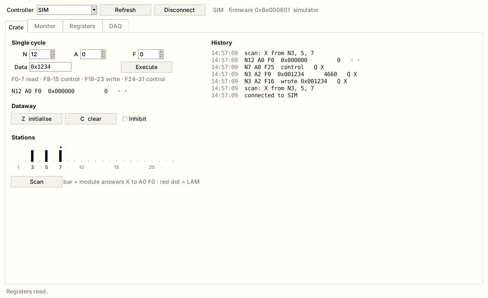
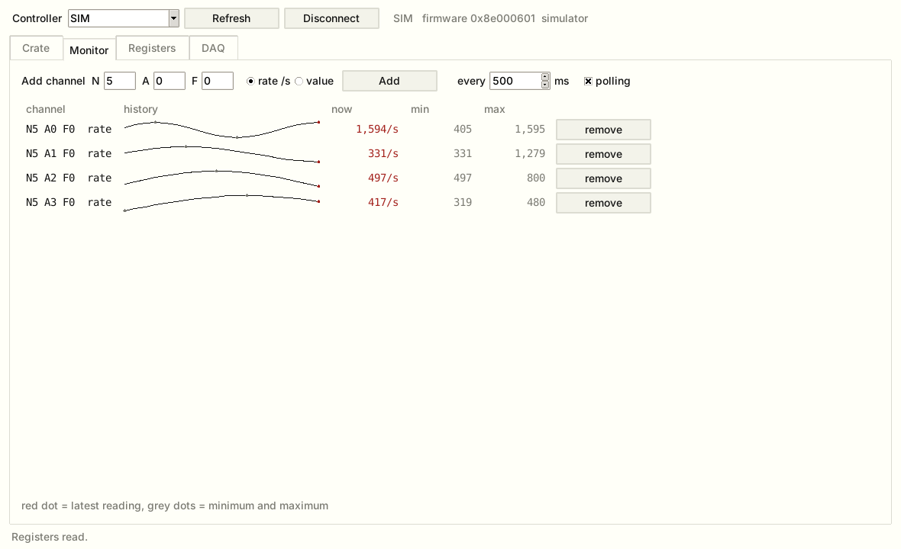
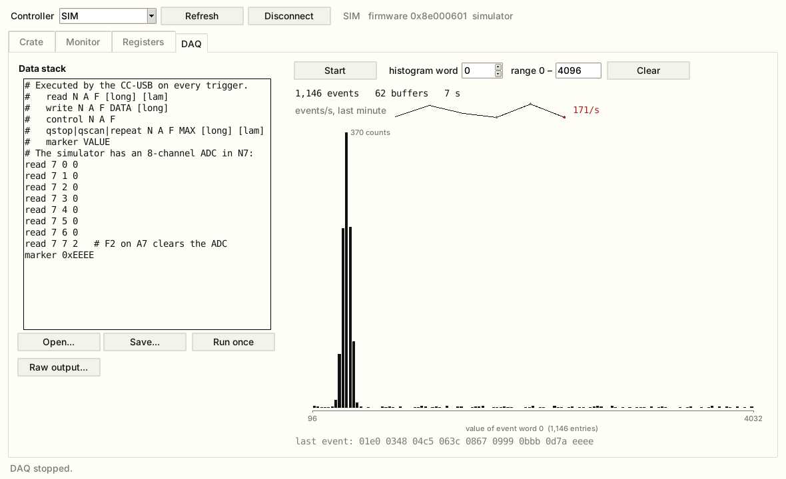

# CCUSB_Drivers

A modern, cross-platform driver for the **W-IE-NE-R CC-USB** CAMAC crate
controller, plus a command-line tool and a small GUI.

* **`libccusb`** — C library on **libusb-1.0** (Linux, Windows, macOS).
  Replaces W-IE-NE-R's `libxxusb`, which needs the long-deprecated
  libusb-0.1.
* **`libxxusb.h` compatibility layer** — existing programs that use
  `CAMAC_read`, `xxusb_stack_execute` and so on recompile unchanged against the
  new library.
* **`ccusb`** — command-line tool: single NAF cycles, Z/C/I, register dump,
  crate scan, stack files, data taking, interactive shell.
* **`ccusb` Python package + `ccusb-gui`** — Python binding (ctypes) and a Tk
  GUI with a crate map, scaler monitor and live DAQ histogram.
* **Built-in simulator** — open serial `SIM` to get a software CC-USB with a
  simulated crate, so everything can be tried and tested without hardware.



## Why the old driver needed replacing

| old `libxxusb` | this driver |
|---|---|
| libusb-0.1 (unmaintained, missing on current Windows/macOS) | libusb-1.0 |
| `xxusb_stack_write` copies up to 4095 words into a 2000-byte stack buffer (overflow) | stacks are bounds-checked (768 data / 256 scaler words) |
| `xxusb_devices_find` returns -1 if *any* W-IE-NE-R device cannot be opened | inaccessible devices are skipped and reported by `ccusb list` |
| `CAMAC_write` silently refuses control functions, so there is no generic way to do F8–F15 / F24–F31 | `ccusb_control()` and `ccusb_naf()` |
| no notion of DAQ mode: an immediate command during data taking mixes its reply into the data stream | immediate commands return `CCUSB_ERR_BUSY` while DAQ runs |
| stale data from a crashed program breaks the next one | `ccusb_open` stops DAQ, drains the FIFO and checks the firmware register |
| 10 ms timeouts on register access | 2 s default, configurable |

## Build

You need a C compiler, CMake ≥ 3.13 and libusb-1.0.

### Linux

```bash
sudo apt install build-essential cmake libusb-1.0-0-dev      # Debian/Ubuntu
```

```bash
sudo dnf install gcc cmake libusb1-devel                     # Fedora/RHEL
```

```bash
cmake -S . -B build
```

```bash
cmake --build build -j
```

```bash
ctest --test-dir build          # unit tests, run against the simulator
```

```bash
sudo cmake --install build && sudo ldconfig
```

**Permissions.** Without a udev rule only root can talk to the controller.
Install the rule once, then replug the CC-USB:

```bash
sudo cp udev/70-wiener-xxusb.rules /etc/udev/rules.d/
```

```bash
sudo udevadm control --reload-rules && sudo udevadm trigger
```

It grants access to the logged-in user and to the `plugdev` group.

### Windows

1. **USB driver.** Windows needs the generic WinUSB driver bound to the
   CC-USB. Download [Zadig](https://zadig.akeo.ie/), plug in the CC-USB,
   choose it in the list (USB ID `16DC 0001`; enable *Options → List All
   Devices* if it is not shown), select **WinUSB** and click *Replace Driver*.
   This replaces the old W-IE-NE-R driver, so the old XXUSBWin software will
   stop working with that controller.
2. **Prebuilt binaries.** Each CI run on GitHub uploads a
   `ccusb-windows-x64` artifact with `ccusb.dll`, `ccusb.exe` and
   `libusb-1.0.dll`.
3. **Building yourself** (Visual Studio 2019+ with vcpkg):

   ```bash
   vcpkg install libusb:x64-windows
   ```

   ```bash
   cmake -S . -B build -DLIBUSB_ROOT=%VCPKG_ROOT%/installed/x64-windows
   ```

   ```bash
   cmake --build build --config Release
   ```

   Put `libusb-1.0.dll` next to `ccusb.dll` / `ccusb.exe`.
   MinGW works too: point `LIBUSB_ROOT` at the libusb release archive.

### macOS

```bash
brew install libusb pkg-config cmake
```

and then the same CMake steps as on Linux. No driver or permissions setup is
needed.

## Command-line tool

```text
ccusb list                          # attached controllers and their serials
ccusb info                          # firmware + all registers
ccusb naf 3 0 16 0x1234             # one cycle; read/write/control from F
ccusb read 3 0 0                    # → N3 A0 F0  data=0x001234 (4660)  Q=1 X=1
ccusb z | ccusb c | ccusb inhibit off
ccusb scan                          # which stations answer X, and LAMs
ccusb reg dgg_a 0x00640010          # write and read back a register
ccusb stack run my.stk              # execute a stack file immediately
ccusb daq examples/adc.stk -n 10 -o run.bin -p 5
ccusb shell                         # interactive prompt
```

`-s CC0123` selects a controller by serial number, `--sim` uses the
simulator, `-v` dumps every USB packet, `-t MS` sets the timeout.

```text
$ ccusb --sim scan
station     1  2  3  4  5  6  7  8  9 10 11 12 13 14 15 16 17 18 19 20 21 22 23
X (A0F0)    .  .  X  .  X  .  X  .  .  .  .  .  .  .  .  .  .  .  .  .  .  .  .
Q (A0F0)    .  .  Q  .  Q  .  .  .  .  .  .  .  .  .  .  .  .  .  .  .  .  .  .
LAM         .  .  .  .  .  .  .  .  .  .  .  .  .  .  .  .  .  .  .  .  .  .  .
```

### Stack files

Stacks (the CC-USB's readout lists) are plain text, one operation per line:

```text
read N A F [long] [lam]                  # 16-bit read, 24-bit with "long",
                                         # "lam" = wait for LAM first
write N A F DATA [long]
control N A F
qstop  N A F MAX [long] [lam]            # repeat until Q=0 (max MAX times)
qscan  N A F MAX [long] [lam]            # step A then N while Q, stop on no X
repeat N A F COUNT [long] [lam]
marker VALUE                             # literal 16-bit word in the data
word VALUE                               # raw stack word
```

`ccusb daq` writes raw buffers as `uint32 word count` + that many 16-bit
words (little endian).

## GUI

```bash
pip install ./python                     # or: export PYTHONPATH=$PWD/python
```

```bash
ccusb-gui                                # or: python -m ccusb.gui --sim
```

The Python package looks for the native library in this order:
`$CCUSB_LIBRARY`, next to the package, `./build`, then the system library
path. To ship the library inside the package, configure with
`-DCCUSB_PYTHON_BUNDLE=ON` before `pip install ./python`. Tk comes with
Python on Windows/macOS; on Linux install `python3-tk`.

| Monitor: scaler rates as sparklines | DAQ: data stack, event rate, histogram |
|---|---|
|  |  |

The plots keep to Tufte's rules: no frames or grid lines, data in ink, values
labelled directly, a range-frame axis that spans only the data, and
sparklines that mark the minimum, maximum and latest reading.

## C API

```c
#include <ccusb/ccusb.h>

ccusb_device *cc;
uint32_t data;
int q, x;

ccusb_open(&cc, NULL);                    /* first CC-USB; "CC0123"; "SIM" */
ccusb_write(cc, 3, 0, 16, 0x1234, &q, &x);
ccusb_read(cc, 3, 0, 0, &data, &q, &x);
ccusb_z(cc);  ccusb_c(cc);  ccusb_inhibit(cc, 0);
ccusb_reg_write(cc, CCUSB_REG_LAM_MASK, 1u << 6);

ccusb_stack s;  ccusb_stack_init(&s);
ccusb_stack_add_read(&s, 7, 0, 0, 0, 0);
ccusb_stack_add_marker(&s, 0xEEEE);
ccusb_stack_load(cc, CCUSB_STACK_DATA, s.words, s.count);
ccusb_daq_start(cc);
/* ccusb_read_buffer() ... ccusb_parse_buffer() ... */
ccusb_daq_stop(cc);           /* then drain until CCUSB_ERR_TIMEOUT */
ccusb_close(cc);
```

Every call returns `CCUSB_OK` (0) or a negative `CCUSB_ERR_*`;
`ccusb_strerror()` explains it. Link with `pkg-config --libs ccusb` or the
CMake target `ccusb::ccusb`. See `include/ccusb/ccusb.h` for the full API and
`examples/`.

## Python API

```python
import ccusb

with ccusb.open("SIM") as cc:            # None = first CC-USB
    cc.write(3, 0, 16, 0x1234)
    r = cc.read(3, 0, 0)                 # Cycle(data=4660, q=True, x=True)
    cc.reg_write("dgg_a", 0x00640010)
    cc.load_stack(ccusb.Stack().read(7, 0, 0).marker(0xEEEE))
    cc.daq_start()
    events = ccusb.parse_buffer(cc.read_buffer(500))
    cc.daq_stop()
```

## Porting programs that used libxxusb

Change the include from the old header to this repository's `libxxusb.h`,
drop `-lusb`, link `-lccusb`. Return values match the original (bytes
transferred, negative on error). Differences:

* `usb_dev_handle` and `struct usb_device` are opaque; do not include
  libusb-0.1's `<usb.h>`.
* `VME_*` (VM-USB) functions are not included.
* `xxusb_register_read` reads CC-USB register `A=RegAddr` through N=25.
* With `CCUSB_SIM=1` in the environment, `xxusb_devices_find()` also lists
  the simulator (serial `SIM`), so old programs can run without hardware.

## The simulator

`ccusb_open(&cc, "SIM")`, `ccusb --sim`, `ccusb.open("SIM")` or the GUI's
`SIM` entry give a software controller that speaks the same USB protocol.
Its crate holds:

| station | module | functions |
|---|---|---|
| N3 | 16 × 24-bit memory | F0 read, F16 write, F9 clear, F8/F10/F25 LAM test/clear/set |
| N5 | 12-channel scaler, 1 kHz … 1 Hz (channels 0–3 modulated) | F0 read, F2 read & clear, F9 clear, F24/F26 disable/enable |
| N7 | 8-channel 12-bit ADC (Gaussian peaks on flat background) | F0 read, F2 read (A7 clears), F25 convert, F8/F9/F10, F24/F26 LAM |

In DAQ mode it triggers at about 180 Hz and runs the loaded data stack per
event, producing buffers in the CC-USB format.

## Testing status

Tested here: the library, CLI, Python binding and GUI on Linux against the
simulator; byte-exact packet encoding against W-IE-NE-R's `libxxusb` and
NSCLDAQ's `CCCUSB` (see [docs/PROTOCOL.md](docs/PROTOCOL.md)); a MinGW
cross-build for Windows. GitHub Actions builds and tests on Linux, macOS and
Windows (MSVC).

Not yet tested on a real CC-USB. Please check the following on hardware first
and report what you see:

1. `ccusb list` and `ccusb info` (open handshake, register reads).
2. `ccusb scan` and single read/write cycles on a known module.
3. `ccusb stack show data` — the reply format of a stack read-back (count
   word first?) comes from reference code, not the manual.
4. A short `ccusb daq` run, which checks buffer and event headers with your
   global-mode settings.

## Troubleshooting

* **`access denied`** on Linux: install the udev rule (see above) and replug.
  On Windows: install WinUSB with Zadig.
* **`device busy`**: another program (an old DAQ, a second `ccusb`) holds
  the controller, or DAQ mode is running in this handle.
* **Timeouts after a crash**: `ccusb info` re-synchronises (it stops DAQ and
  drains the FIFO). If that fails, power-cycle the crate.
* **`-v`** on the command line (or `ccusb_set_trace`) prints every USB
  packet.

## Layout

```text
include/ccusb/ccusb.h    C API
include/libxxusb.h       legacy API
src/ccusb.c              protocol layer
src/usb.c                libusb-1.0 transport
src/sim.c                simulator
src/xxusb_compat.c       legacy API implementation
tools/ccusb_cli.c        ccusb command-line tool
python/ccusb/            Python binding and GUI
tests/, python/tests/    unit tests
udev/                    Linux permission rule
examples/                C, Python and stack-file examples
docs/PROTOCOL.md         wire protocol notes
```
